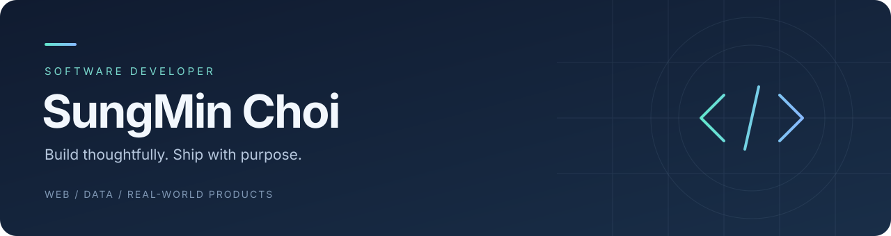

  

  <strong>기획부터 설계·개발·배포·운영까지, 실제 사용자가 쓰는 서비스를 만듭니다.</strong>

  
  

### 안녕하세요, 최성민입니다.

화면을 구현하는 데서 시작해 데이터 구조, 권한, 배포와 운영 문제까지 이어서 해결합니다.
사용 환경의 제약을 이해하고, 실제 사용 과정에서 발견한 문제를 개선하는 일을 좋아합니다.

- **서비스 구현** — 문제 정의부터 사용자가 쓰는 화면과 운영 도구까지
- **데이터와 권한** — PostgreSQL, Supabase의 RLS·RPC·트리거를 활용한 설계
- **운영 개선** — 테스트, 상태 보고와 자동화로 반복되는 문제 줄이기

### Selected work

<table>
<tr>
<td width="50%" valign="top">

#### PRN · 모바일 문제은행

외과 시험 문항 **1,600여 개**를 풀고 검색하는 모바일 문제은행.

자료 파싱 → 문항 검수 → 공개 흐름과 DB 권한·채점·수정 이력을 구현했습니다.

`Next.js` `TypeScript` `PostgreSQL` `Supabase`

[설계·구현 이야기 →](https://github.com/firstsm41/portfolio/tree/main/projects/prn)

</td>
<td width="50%" valign="top">

#### 스마트월 · 병원 TV 관리

병원 대기실 **TV 9대**의 콘텐츠·전원·예약을 웹에서 관리.

Python 도우미로 내부망 TV를 제어하고, 브라우저 영상 변환으로 4K 영상 5개의 용량을 **208.7MB → 59.7MB**로 줄였습니다.

`React` `TypeScript` `Python` `Supabase`

[설계·구현 이야기 →](https://github.com/firstsm41/portfolio/tree/main/projects/smartwall)

</td>
</tr>
</table>

### More projects

| 프로젝트 | 하는 일 | 주요 기술 |
| :--- | :--- | :--- |
| [티테이블 POS](https://github.com/firstsm41/teatable_pos) | 카페 메뉴·주문 관리와 주문 완료 처리 | Next.js · TypeScript · Supabase |
| [실시간 퀴즈](https://github.com/firstsm41/jeonjicheon-quiz) | QR 참여와 문항별 응답 현황 실시간 집계 | JavaScript · Supabase |
| [Medicine WMS](https://github.com/firstsm41/medicine-wms) | 의약품 창고 입고·출고·재고 관리 팀 프로젝트 | Java · MySQL |
| [All Live Young](https://github.com/ceo92/all-live-young) | 의약품 WMS 팀 프로젝트 | Java |

### Tools I use

  
  
  
  
  
  
  

---

  <a href="https://github.com/firstsm41/portfolio">프로젝트 자세히 보기</a> · <a href="mailto:firstsm41@naver.com">firstsm41@naver.com</a>

